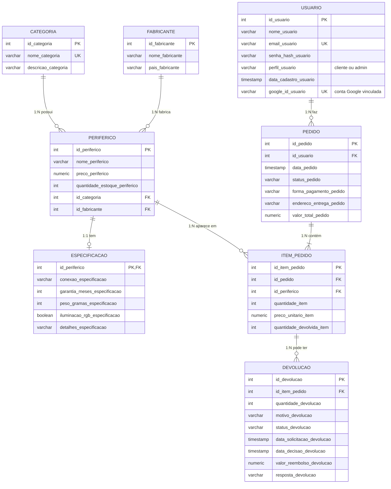

# 🎮 Gearhub - Loja de Periféricos (versão definitiva, 4º bimestre)

> Visual no estilo de grandes lojas de tecnologia (azul e amarelo, fontes Sora e Inter do Google Fonts), com **espaços prontos para as imagens do mascote e das promoções**, **PIX com QR Code real** e **recuperação de senha por e-mail**.

Aplicação web **Cliente/Servidor** no padrão **MVC**: **Node.js + Express** no servidor, **PostgreSQL** como banco e **HTML/CSS/JavaScript** puro no cliente.
Projeto de DW1, evolução do modelo *CandyShop*. No 3º bimestre foram feitos os CRUDs; no 4º foram acrescentados **login/logout com cookies**, **visão do cliente e do administrador**, **carrinho, pedidos, pagamento (apresentado)** e **devolução de itens por pedido**.

- **Aluno:** Lucas Rafael (Bigas)
- **Turma:** M32
- **Ano:** 2026

---

## 1. Planejamento

### 1.1 Papéis de usuário

| Papel | O que precisa fazer |
|---|---|
| **Visitante** | Ver a loja, buscar produtos, montar o carrinho, cadastrar-se e entrar |
| **Cliente** | Finalizar compras, acompanhar pedidos, **devolver itens** (um, vários ou todos) |
| **Funcionário (administrador)** | Gerir periféricos (com imagem), categorias, fabricantes e especificações; atualizar o status dos pedidos; **aprovar ou recusar devoluções**; gerir usuários |

O sistema tem 3 perfis de usuário: `cliente`, `admin` (funcionário) e `ambos` (**cliente e funcionário**). No login:

- só cliente → abre o dashboard do cliente;
- só funcionário → abre o dashboard do administrador;
- cliente e funcionário → abre uma **janela perguntando como quer entrar**.

### 1.2 Requisitos funcionais

- RF01 Cadastro de cliente (e-mail único, senha com no mínimo 6 caracteres).
- RF02 Login e logout usando **cookies**, com escolha da visão para quem é cliente e funcionário.
- RF03 Catálogo com busca, filtro por categoria, ficha técnica e carrinho.
- RF04 Conferir o pedido e clicar em **Pagamento**: se não estiver logado, vai para o login e volta; se estiver, escolhe endereço e forma de pagamento (PIX, cartão de crédito, cartão de débito ou boleto).
- RF05 O cliente acompanha seus pedidos.
- RF06 O cliente pede devolução de **itens individuais, de vários itens ou de todos**, inclusive só **parte da quantidade** (ex.: 1 de 3 mouses).
- RF07 O administrador atualiza o status do pedido: pago → enviado → entregue, ou cancela antes da entrega.
- RF08 O administrador aprova/recusa devoluções. Aprovar devolve o produto ao estoque, registra o reembolso e recalcula o status do pedido.
- RF09 CRUD de periféricos (com upload de imagem), categorias, fabricantes e especificações (só administrador).
- RF10 O administrador vê um painel com números gerais e gerencia os perfis dos usuários.
- RF11 Pagamento por **PIX real**: gera QR Code e "copia e cola" (BR Code) do pedido; o pedido fica "aguardando pagamento" até o funcionário confirmar o recebimento.
- RF12 **Recuperação de senha por e-mail**: link com validade de 1 hora e uso único.
- RF13 **Entrar com Google**: cria a conta de cliente na primeira vez ou entra na conta existente (vinculada pelo e-mail verificado).

### 1.3 Requisitos não funcionais

- RNF01 Senhas guardadas como **hash (scrypt)**, nunca em texto puro.
- RNF02 Cookie de sessão **HttpOnly**, **SameSite=Lax**, assinado com **HMAC-SHA256** e com validade de 2 horas.
- RNF03 Preço e estoque são conferidos **no servidor** na hora da compra (o navegador só envia ID e quantidade).
- RNF04 Compra, cancelamento e devolução usam **transação** (`BEGIN`/`COMMIT`/`ROLLBACK`): ou tudo acontece, ou nada.
- RNF05 Credenciais do banco em variáveis de ambiente (`.env`), fora do GitHub.
- RNF06 Consultas SQL parametrizadas (`$1, $2`) contra SQL injection.
- RNF08 O login com Google é conferido **no servidor**: assinatura do token, validade e se ele foi emitido para o nosso Client ID; e-mail não verificado é recusado.
- RNF07 No banco fica só o **hash** do token de recuperação de senha; a resposta de "esqueci a senha" é a mesma exista ou não o e-mail (não revela quem tem conta).

### 1.4 Wireframes

O esboço feito à mão está em [`documentacao/wireframes.jpg`](documentacao/wireframes.jpg) e foi implementado assim:

| Wireframe | Página |
|---|---|
| Inicial (destaques + categorias em círculos) | `frontend/inicio/inicio.html` |
| Produtos (grade de cartões) | `frontend/produtos/produtos.html` |
| Entre | `frontend/login/login.html` |
| Cadastre-se | `frontend/cadastro/cadastro.html` |
| Admin: "Bem-vindo ao sistema de administração" | `frontend/admin/admin.html` |
| Admin: formulário + imagem | `frontend/periferico/periferico.html` |

Diferenças em relação ao desenho, de propósito:

- Todas as páginas têm **menu de navegação e rodapé**, exigidos pelo enunciado e que o esboço não mostra.
- O painel do administrador tem **7 módulos** (o esboço mostra 4 caixas), além dos números gerais; o botão **Logout** fica no canto inferior esquerdo, como no desenho, e também há um "Sair" no cabeçalho.
- Na página inicial, as categorias em círculo quebram em várias linhas (o esboço mostra uma linha só, com seta).
- O botão **Google** do cadastro fica no canto superior direito do quadro, como no desenho (só o "G"); no login ele aparece grande, abaixo do formulário.

---

## 2. Páginas

**Cliente:** Início · Produtos · Login · Cadastro · Esqueci minha senha · Nova senha · Carrinho (com pagamento) · Meus pedidos (com devoluções)
**Funcionário (administrador):** Painel · Periféricos · Categorias · Fabricantes · Especificações · Pedidos · Devoluções · Usuários

Todas usam `header`, `nav`, `main`, `section`, `aside` e `footer`, um único CSS externo (`frontend/css/estilo.css`) e o rodapé com nome, turma e ano.

---

## 3. Banco de dados



| Requisito | Onde está |
|---|---|
| Tabelas independentes | `categoria`, `fabricante`, `usuario` |
| **1:N** | `categoria`/`fabricante` → `periferico`; `usuario` → `pedido`; `pedido` → `item_pedido`; `item_pedido` → `devolucao` |
| **1:1** | `periferico` → `especificacao` (a PK de `especificacao` também é FK) |

`documentacao/gearhub.sql` tem os `CREATE TABLE` e os `INSERT INTO` (10 categorias, 10 fabricantes, 10 usuários, 12 periféricos, 12 especificações, 10 pedidos, 16 itens de pedido e 10 devoluções).

Detalhes de modelagem:
- `item_pedido` copia o **preço unitário** no momento da compra: mudar o preço do produto depois não altera pedidos antigos.
- `quantidade_devolvida_item` tem `CHECK` para nunca passar da quantidade comprada.
- Excluir categoria/fabricante/periférico que já tem vínculos é bloqueado (`23503`). Excluir um periférico remove sua especificação (`ON DELETE CASCADE`).

---

## 4. Arquitetura (MVC)

```
Gearhub
├── backend
│   ├── controllers/        # lógica de negócio + SQL (auth, pedido, devolucao, usuario, admin, periferico...)
│   ├── routes/             # mapeamento dos endpoints (Router)
│   ├── middlewares/auth.js # cookie assinado, identificar / exigirLogin / exigirAdmin
│   ├── services/           # pix.js (BR Code + QR Code) e email.js (SMTP)
│   ├── database.js         # conexão PostgreSQL via .env
│   ├── server.js
│   ├── .env                # NÃO vai para o GitHub
│   └── .env.example
├── frontend                # View: HTML + CSS + JS
│   ├── css/estilo.css
│   ├── js/comum.js         # api(), usuário logado, carrinho, formatações
│   └── inicio/ produtos/ login/ cadastro/ esqueci_senha/ redefinir_senha/ carrinho/ meus_pedidos/
│       admin/ periferico/ categoria/ fabricante/ especificacao/
│       admin_pedidos/ admin_devolucoes/ admin_usuarios/
├── imagens/                # <id_periferico>.png (fotos dos produtos)
│   └── site/               # logo, banners, promoções e mascote (veja a seção 6)
├── documentacao/           # gearhub.sql + wireframes.jpg
└── README.md
```

### Login com cookies

1. `POST /auth/login` confere o e-mail e a senha (`scrypt`) e responde com `Set-Cookie: gearhub_sessao=<dados>.<assinatura>; HttpOnly; SameSite=Lax`.
2. O navegador devolve o cookie sozinho em toda requisição.
3. O middleware `identificar` (rodando antes de todas as rotas) confere a assinatura, busca o usuário no banco e coloca em `req.usuario`.
4. `exigirLogin` barra visitantes (**401**) e `exigirAdmin` barra quem não é administrador (**403**).
5. `POST /auth/logout` apaga o cookie (`Max-Age=0`).

Se alguém alterar o cookie, a assinatura HMAC não bate e o servidor o ignora. O perfil nunca é aceito do formulário de cadastro: todo cadastro cria um **cliente**.

### Fluxo do núcleo: compra → entrega → devolução

```
Cliente finaliza compra ──► cartão/boleto: pedido "pago" (simulado) | PIX: "aguardando pagamento" + QR Code
Admin (PIX): confirma o recebimento ──► "pago"
Admin: pago ──► enviado ──► entregue            (ou cancela antes de entregar: estoque volta)
Cliente (pedido entregue): solicita devolução de itens/quantidades ──► devolução "em análise"
Admin aprova ──► estoque volta, reembolso registrado, pedido vira "devolvido_parcial" ou "devolvido"
Admin recusa ──► só registra a resposta
```

A devolução é **por item e por quantidade**: o cliente marca os itens e a quantidade de cada um, ou usa **"Devolver todos"** para o que ainda resta. Itens já devolvidos ou em análise não podem ser devolvidos de novo.

### Pagamento

- **PIX (real):** o sistema monta o **BR Code** do Banco Central (com CRC16) com a chave definida em `PIX_CHAVE` no `.env` e o valor do pedido, e mostra o **QR Code** e o **copia e cola**. Qualquer app de banco consegue pagar. O pedido fica **"aguardando pagamento"** e o funcionário confirma o recebimento em *Pedidos → Confirmar pagamento* (ou cancela, e o estoque volta). O PIX estático não avisa o sistema quando é pago, por isso a confirmação é manual; para confirmação automática seria preciso um provedor de pagamento (Mercado Pago, Efí etc.).
- **Cartão de crédito, cartão de débito e boleto:** apenas apresentados (simulação, como permitido no enunciado). O pedido nasce como "pago".

### Login com Google

O botão usa o **Google Identity Services**. Depois que a pessoa escolhe a conta, o Google entrega ao navegador um token assinado; o navegador o envia a `POST /auth/google` e o **servidor confere o token** (`google-auth-library`) antes de logar:

- já entrou antes com aquele Google → entra na mesma conta;
- o e-mail (verificado pelo Google) já existe no sistema → a conta é **vinculada** e a pessoa entra nela;
- primeira vez → cria um **cliente** (nunca administrador) com nome e e-mail do Google. Quem quiser uma senha própria usa "Esqueci minha senha".

**Como ativar (uma vez):**

1. Acesse o [Google Cloud Console](https://console.cloud.google.com/) e crie um projeto (ex.: "Gearhub").
2. Em *APIs e serviços → Tela de permissão OAuth*, escolha **Externo**, informe o nome do app e o seu e-mail e salve. Enquanto o app está em modo de teste, adicione em *Usuários de teste* os e-mails que vão entrar (inclusive o seu).
3. Em *APIs e serviços → Credenciais → Criar credenciais → ID do cliente OAuth*, tipo **Aplicativo da Web**.
4. Em **Origens JavaScript autorizadas** adicione `http://localhost:3001` (e o endereço do site, se um dia publicar). Não precisa de URI de redirecionamento.
5. Copie o **ID do cliente** (termina em `.apps.googleusercontent.com`) para `GOOGLE_CLIENT_ID` no `backend/.env` e reinicie o servidor.
6. Abra o site por **http://localhost:3001** (com `127.0.0.1` o Google recusa) e use o botão em *Entrar* ou *Cadastre-se*.

Sem `GOOGLE_CLIENT_ID`, o botão continua na tela e explica que o login com Google não foi ativado.

### Recuperação de senha por e-mail

1. Em *Esqueci minha senha* a pessoa informa o e-mail → `POST /auth/esqueci-senha`.
2. O servidor cria um token aleatório, guarda só o **hash** dele com validade de 1 hora e envia por e-mail o link `.../redefinir_senha.html?token=...`.
3. Na página do link a pessoa escolhe a nova senha → `POST /auth/redefinir-senha`. O token é apagado (uso único).

Sem SMTP configurado, o link aparece **no terminal do servidor** (útil para testar). Configure as variáveis `SMTP_*` do `.env` para enviar de verdade.

### Endpoints

O detalhamento de cada rota (corpo da requisição, resposta JSON e erros) está em [`documentacao/especificacao_api.md`](documentacao/especificacao_api.md).

| Método | Rota | Quem acessa |
|---|---|---|
| POST | `/auth/cadastro`, `/auth/login`, `/auth/google`, `/auth/logout`, `/auth/esqueci-senha`, `/auth/redefinir-senha` · GET `/auth/eu`, `/auth/config` | público |
| GET | `/periferico/listar`, `/periferico/destaques`, `/periferico/:id` · `/categoria`, `/fabricante`, `/especificacao` (`/listar`, `/:id`) | público |
| POST/PUT/DELETE | `/periferico`, `/categoria`, `/fabricante`, `/especificacao` · POST `/periferico/upload/:id` | admin |
| POST | `/pedido` | logado |
| GET | `/pedido/meus`, `/pedido/:id` e `/pedido/:id/pix` (dono ou admin) | logado |
| GET | `/pedido/listar` · PUT `/pedido/:id/status` | admin |
| POST | `/devolucao` · GET `/devolucao/minhas` | logado |
| GET | `/devolucao/listar` · PUT `/devolucao/:id/decidir` | admin |
| GET | `/usuario/listar` · PUT `/usuario/:id/perfil` · GET `/admin/resumo` | admin |

---

## 5. Como executar

**Pré-requisitos:** Node.js 18+ e PostgreSQL.

1. Instale as dependências
   ```bash
   npm install
   ```
2. Crie o banco (no pgAdmin ou `psql`)
   ```sql
   CREATE DATABASE gearhub;
   ```
3. Rode o script de tabelas e carga inicial **no banco `gearhub`**
   ```bash
   psql -U postgres -d gearhub -f documentacao/gearhub.sql
   ```
4. Crie o `.env`: copie `backend/.env.example` para `backend/.env` e ajuste os valores
   ```env
   DB_HOST=127.0.0.1
   DB_PORT=5432
   DB_NAME=gearhub
   DB_USER=postgres
   DB_PASSWORD=sua_senha_aqui
   PORT=3001
   SESSION_SECRET=troque-por-um-texto-longo-e-aleatorio
   APP_URL=http://localhost:3001

   # Login com Google (deixe vazio para desativar; veja a seção "Login com Google")
   GOOGLE_CLIENT_ID=123456789-abcdef.apps.googleusercontent.com

   # PIX real (deixe PIX_CHAVE vazio para desativar o PIX)
   PIX_CHAVE=sua-chave-pix
   PIX_NOME=SEU NOME
   PIX_CIDADE=SUA CIDADE

   # E-mail de recuperação de senha (deixe SMTP_HOST vazio para ver o link só no terminal)
   SMTP_HOST=smtp.gmail.com
   SMTP_PORT=587
   SMTP_SECURE=false
   SMTP_USER=seu-email@gmail.com
   SMTP_PASS=senha-de-app-do-gmail
   SMTP_FROM=Gearhub <seu-email@gmail.com>
   ```
   - **PIX:** o dinheiro cai na chave informada. Chave aleatória, e-mail e CPF (só números) funcionam; telefone vai no formato `+5544999999999`. Teste com valores pequenos.
   - **Gmail:** ative a verificação em duas etapas e crie uma *senha de app* (a senha normal não funciona).
5. Inicie
   ```bash
   npm start
   ```
6. Acesse **sempre por** http://localhost:3001 (o servidor também entrega o front-end; o cookie de login depende disso).

### Contas de teste

| Perfil | E-mail | Senha |
|---|---|---|
| Funcionário (administrador) | `admin@gearhub.com` | `admin123` |
| Cliente **e** funcionário (mostra a janela de escolha) | `bruno@gearhub.com` | `cliente123` |
| Cliente | `ana@gearhub.com` (também carla, diego, elisa, felipe, gabriela, henrique, isabela) | `cliente123` |

### Roteiro de demonstração

1. Como visitante: abra a loja, filtre por categoria, adicione itens ao carrinho e clique em **Pagamento** (vai para o login).
2. Cadastre-se (ou entre como `ana`): você volta ao carrinho, escolhe o pagamento e confirma.
3. Entre como **admin** (ou como `bruno` e escolha "funcionário"): em *Pedidos*, marque o pedido como **enviado** e depois **entregue**.
4. Volte como cliente: em *Meus pedidos*, devolva **só um item** (ou parte da quantidade) e depois **"Devolver todos"**.
5. Como admin: em *Devoluções*, aprove e veja o estoque voltar e o status do pedido mudar.

---

## 6. Onde trocar as imagens (mascote, banners e promoções)

Salve os arquivos em **`imagens/site/`** com o nome exato da tabela e atualize a página com `Ctrl + F5`. Não precisa mexer no HTML. Enquanto o arquivo não existe, o site mostra um quadro amarelo **"TROQUE AQUI"** com o nome do arquivo.

| Arquivo | Onde aparece | Tamanho sugerido |
|---|---|---|
| `logo.png` | Cabeçalho (troca o texto "Gearhub") | altura 84 px, fundo transparente |
| `banner-1.jpg`, `banner-2.jpg`, `banner-3.jpg` | Carrossel da página inicial | 1200 × 420 px |
| `promo-1.jpg`, `promo-2.jpg`, `promo-3.jpg` | "Promoções especiais" (inicial) | 400 × 220 px |
| `faixa-promo.jpg` | Faixa larga de promoção (inicial) | 1200 × 140 px |
| `banner-produtos.jpg` | Topo da página de produtos | 1200 × 140 px |
| `mascote.png` | Mascote na página inicial | 500 × 625 px, PNG transparente |
| `mascote-login.png` | Mascote no login, cadastro e recuperação de senha | 400 × 500 px, PNG transparente |
| `mascote-vazio.png` | Mascote com carrinho vazio ou sem pedidos | 400 × 400 px, PNG transparente |

As cores ficam nas variáveis do início de `frontend/css/estilo.css` (`--azul-*` e `--amarelo-*`).

---

## 7. Tecnologias

Node.js · Express · PostgreSQL (`pg`) · dotenv · cors · Multer · Sharp · nodemailer (e-mail) · qrcode (QR Code do PIX) · google-auth-library e Google Identity Services (login com Google) · `crypto` (scrypt e HMAC, nativo do Node) · HTML5 · CSS3 · JavaScript · Google Fonts (Sora e Inter)
